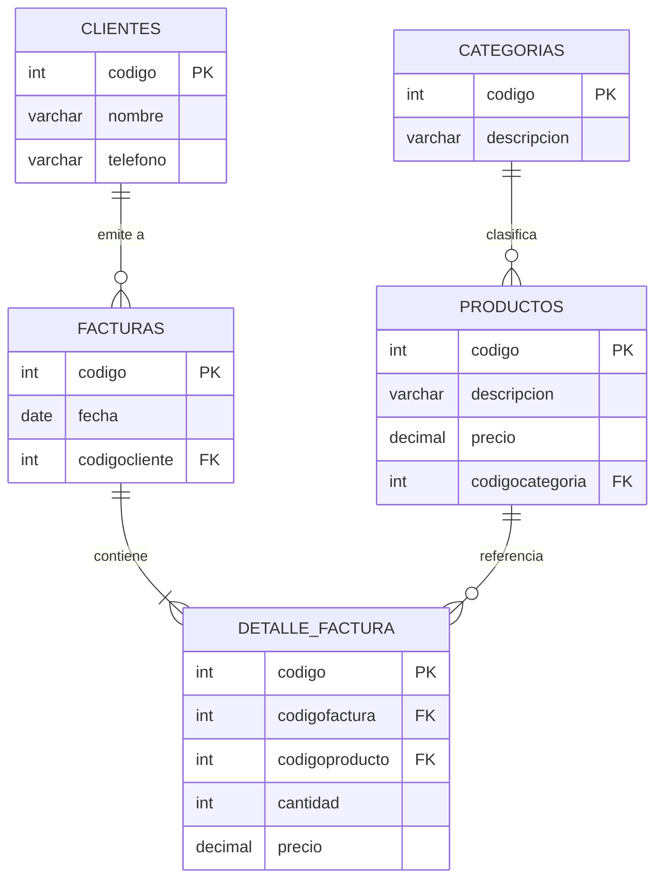

# Sistema Web de Facturación e Inventario

[](https://www.php.net/)
[](https://www.mysql.com/)
[](https://getbootstrap.com/)
[](http://www.fpdf.org/)
[](LICENSE)

Sistema de gestión comercial y facturación desarrollado en **PHP** y **MySQL**, diseñado para agilizar el proceso de ventas, control de catálogo de productos, registro de clientes y emisión automatizada de comprobantes de pago en formato PDF.

---

## 📌 Tabla de Contenidos

- [Características Principales](#-características-principales)
- [Arquitectura y Estructura](#-arquitectura-y-estructura)
- [Modelo de Base de Datos](#-modelo-de-base-de-datos)
- [Requisitos Previos](#-requisitos-previos)
- [Instalación y Puesta en Marcha](#-instalación-y-puesta-en-marcha)
- [Uso del Sistema](#-uso-del-sistema)
- [Licencia](#-licencia)

---

## 🌟 Características Principales

* **Módulo de Facturación Dinámica:**
  * Selección interactiva de clientes y productos mediante modales.
  * Agregado en tiempo real de ítems al detalle de factura con cálculo automático de subtotales y totales.
  * Eliminación unitaria de líneas de detalle y cancelación de comprobantes.
* **Emisión de Comprobantes PDF:**
  * Generación de facturas formateadas listas para impresión y descarga con la librería **FPDF**.
* **Gestión de Catálogo (Categorías y Productos):**
  * Clasificación de artículos por familias/categorías.
  * Control de precios unitarios y descripciones de inventario.
* **Directorio de Clientes:**
  * Registro, edición y consulta rápida de clientes con datos de contacto.
* **Interfaz Responsiva:**
  * Construida con **Bootstrap** y **jQuery** con llamadas asíncronas (AJAX) para una navegación fluida sin recargar toda la página.

---

## 📁 Arquitectura y Estructura

```text
Proyecto-facturacion/
├── categorias/
│   ├── administracion.html     # Vista de gestión de categorías
│   └── procesar.php            # Controlador AJAX para CRUD de categorías
├── clientes/
│   ├── administracion.html     # Vista de gestión de clientes
│   └── procesar.php            # Controlador AJAX para CRUD de clientes
├── productos/
│   ├── administracion.html     # Vista de gestión de productos
│   └── procesar.php            # Controlador AJAX para CRUD de productos
├── css/                        # Estilos CSS y Bootstrap
├── js/                         # jQuery, Popper y scripts de interacción
├── fpdf/                       # Motor FPDF para generación de documentos
├── imagenes/                   # Logotipo y recursos gráficos
├── conexion.php                # Capa de conexión PDO/MySQLi con soporte env
├── facturacion.php             # Interfaz principal de emisión de facturas
├── facturacion.sql             # Dump de la base de datos (estructura y datos demo)
├── pdffactura.php              # Generador de comprobante PDF
├── procesar.php                # Lógica del backend para emisión de facturas
├── recuperardetalle.php        # Consulta AJAX para detalle de ítems
├── borrarfactura.php           # Cancelación de facturas
├── borrarproductodetalle.php   # Eliminación de ítems del detalle
├── .gitignore
├── LICENSE
└── README.md
```

---

## 🗄️ Modelo de Base de Datos

El sistema utiliza una base de datos relacional MySQL estructurada en las siguientes tablas clave:



---

## 📋 Requisitos Previos

* **Servidor Web:** Apache / Nginx (ej. [XAMPP](https://www.apachefriends.org/), [Laragon](https://laragon.org/) o [WampServer](https://www.wampserver.com/)).
* **PHP:** Versión 7.4 o superior (con extensión `mysqli` habilitada).
* **Base de Datos:** MySQL 5.7+ o MariaDB 10.x.

---

## 🚀 Instalación y Puesta en Marcha

### 1. Clonar el repositorio
Ubica el proyecto dentro de la carpeta pública de tu servidor web (`htdocs` en XAMPP o `www` en Laragon):

```bash
cd C:\xampp\htdocs
git clone https://github.com/MrAldox/Proyecto-facturacion.git
```

### 2. Importar la Base de Datos
1. Abre **phpMyAdmin** (`http://localhost/phpmyadmin`) o tu cliente MySQL preferido.
2. Crea una base de datos llamada `facturacion` (o usa la consola):
   ```bash
   mysql -u root -p < facturacion.sql
   ```
3. El script creará automáticamente las tablas necesarias e insertará datos iniciales de prueba.

### 3. Configuración de Conexión
Si tus credenciales locales de MySQL son las predeterminadas (`usuario: root`, `clave: ""`), no necesitas tocar nada. 
Si utilizas credenciales personalizadas, puedes definirlas mediante variables de entorno o ajustar `conexion.php`:
```php
$server  = getenv('DB_HOST') ?: "localhost";
$usuario = getenv('DB_USER') ?: "root";
$clave   = getenv('DB_PASS') ?: "";
$base    = getenv('DB_NAME') ?: "facturacion";
```

### 4. Ejecución
Inicia los servicios de Apache y MySQL en tu panel de control y abre en el navegador:
```text
http://localhost/Proyecto-facturacion/facturacion.php
```

---

## 🖥️ Uso del Sistema

1. **Catálogos:** Ingresa a `/categorias`, `/clientes` o `/productos` para administrar los registros maestros.
2. **Generar Factura:** En `/facturacion.php`, selecciona el cliente y añade productos indicando la cantidad deseada.
3. **Imprimir:** Haz clic en **Confirmar Factura** para emitir el comprobante y abrir la vista previa en PDF generada con FPDF.

---

## 📄 Licencia

Este proyecto está bajo la Licencia [MIT](LICENSE).
Desarrollado por [Eduardo Martinez](https://github.com/MrAldox).
